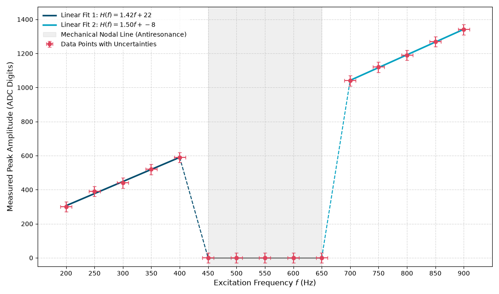
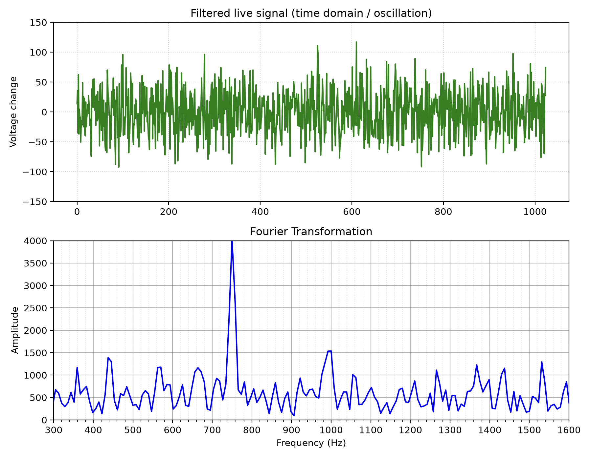

# Non-Contact Intensity-Based Laser Vibrometer

A non-contact, intensity-based **laser vibrometer** utilizing the optical **knife-edge technique**, developed and metrologically characterized as part of the *Physical Metrology* module at University of Oldenburg. 

The system combines a minimal optomechanical setup, high-speed embedded data acquisition (**STM32F446RE**), and real-time digital signal processing (**Python**) to map structural transfer functions and detect mechanical eigenmodes without physical sensor loading.

---

## 📊 Experimental Results & Visuals

| Experimental Transfer Function $H(f)$ | Real-Time Oscilloscope & FFT Monitor |
| :---: | :---: |
|  |  |

---

## 🔬 Measurement Principle & Signal Chain

Traditional contact sensors (e.g., piezoelectric accelerometers) introduce dead-weight to lightweight structures, altering intrinsic resonance frequencies and damping. This instrument avoids structural interference via a four-stage opto-digital pipeline:

1. **Optical Modulation (Knife-Edge Method):** A continuous-wave laser diode reflects off a microscopic triangular mirror mounted on a prestressed polymer membrane. The static beam is aligned precisely onto the active edge (flank) of a photodiode.
2. **Acoustic Excitation:** Sinusoidal sound waves induce angular oscillations of the mirror, sweeping the laser spot across the photodiode boundary and modulating the photocurrent.
3. **Embedded ADC Acquisition:** The resulting voltage signal is digitized continuously by the 12-bit ADC of an **STM32F446RE Nucleo** microcontroller at a calibrated hardware sampling rate of **$f_s = 8\text{ kHz}$** and streamed via UART/USB (`115200 baud`).
4. **Real-Time DSP & Spectral Analysis:** A Python backend removes DC offsets, applies a **3rd-order digital Butterworth bandpass filter** ($40\text{ Hz} – 4000\text{ Hz}$) to suppress ambient light drift and 50 Hz mains hum, and computes real-time Fast Fourier Transforms (FFT).

---

## 📈 Key Metrological Findings (200 Hz – 900 Hz Sweep)

The transducer membrane was characterized across an acoustic sweep from $200\text{ Hz}$ to $900\text{ Hz}$ ($\Delta f = \pm 10\text{ Hz}$, $\Delta A = \pm 30\text{ ADC digits}$), revealing three distinct mechanical regimes:

* **Fundamental Linear Coupling ($200\text{ Hz} – 400\text{ Hz}$):** In-phase membrane translation governed by linear sensitivity:
  $$H_1(f) = (1.42 \pm 0.05)\,\frac{\text{ADC digits}}{\text{Hz}} \cdot f + 14.0$$
* **Macro-Mechanical Antiresonance / Nodal Line ($450\text{ Hz} – 650\text{ Hz}$):** Abrupt signal drop into the noise floor ($\approx 0\text{ ADC digits}$). The membrane splits into out-of-phase partial vibrations, leaving the central mirror at a stationary displacement node ($\Delta s = 0$).
* **Higher-Order Harmonic Resonance ($700\text{ Hz} – 900\text{ Hz}$):** Transition into a concentric harmonic mode with upward baseline shift (peaking at $1340\text{ ADC digits}$ at $900\text{ Hz}$):
  $$H_2(f) = (1.50 \pm 0.06)\,\frac{\text{ADC digits}}{\text{Hz}} \cdot f - 10.0$$
